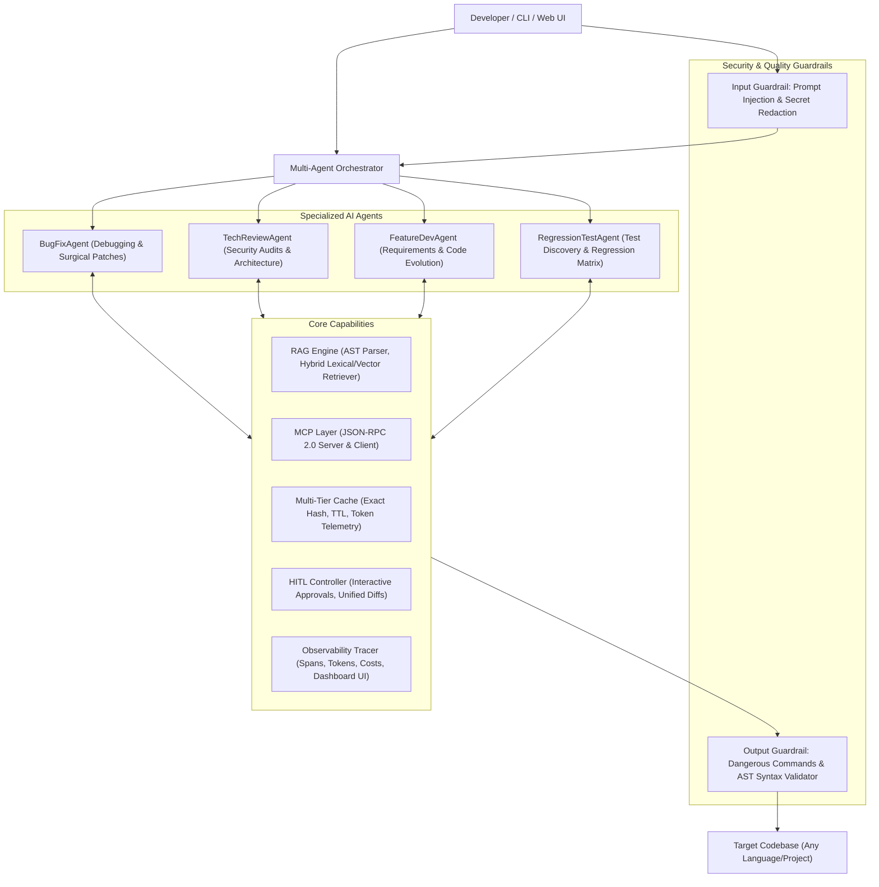

# Agentic AI Framework

An advanced, project-agnostic **Autonomous Agentic AI Framework for Software Engineering**.

Equipped with **4 specialized AI agents**, **Codebase RAG**, **Model Context Protocol (MCP)**, **Multi-Agent Orchestration**, **Dual-Phase Guardrails**, **Multi-Tier Caching**, **Human-in-the-Loop (HITL)** controls, and **Real-Time Observability**.

---

## 🚀 Key Framework Features

| Component | Capabilities |
|---|---|
| **🤖 4 Specialized AI Agents** | • **`BugFixAgent`**: Autonomous diagnosis, triage, stack trace analysis & surgical patch application.<br>• **`TechReviewAgent`**: Deep static analysis, OWASP security audits, architecture & code smell reviews.<br>• **`FeatureDevAgent`**: Translates specs into modular implementations, scaffolds code, maintains compatibility.<br>• **`RegressionTestAgent`**: **Dedicated Regression Gatekeeper.** Auto-runs immediately whenever `BugFixAgent` or `FeatureDevAgent` runs, verifying that code modifications introduced zero regressions. |
| **🧠 Codebase RAG** | AST-based code parser, symbol extractor (classes, functions, methods), dense 128-dim vector embeddings, and a **hybrid retriever** combining lexical BM25 symbol matching with vector semantics. |
| **🔌 Model Context Protocol (MCP)** | Standard **JSON-RPC 2.0** MCP implementation. Includes an **MCP Server** to expose codebase tools to external IDEs (Cursor, Claude Desktop, Antigravity) and an **MCP Client** to integrate external MCP tools. |
| **🎼 Multi-Agent Orchestrator** | Dynamic task planner that breaks down complex user engineering requests into an execution graph, manages shared state, and passes context between agents. |
| **🛡️ Dual-Phase Guardrails** | • **Input Guardrail:** Blocks prompt injections, jailbreaks, and automatically redacts secret API keys / credentials.<br>• **Output Guardrail:** Blocks destructive commands (`rm -rf /`, `rmdir /s /q`, format, fork bombs) and validates code syntax via AST before writing. |
| **⚡ Multi-Tier Caching** | Exact SHA-256 LLM response caching with TTL and token telemetry. Eliminates redundant latency and API costs. Tracks saved tokens and cost savings. |
| **👤 Human-in-the-Loop (HITL)** | Interactive terminal approval checkpoints before modifying code or running shell commands. Displays colorized unified diffs with **Approve `[y]`**, **Reject `[n]`**, or **Feedback `[f]`** options. |
| **📊 Real-Time Observability** | OpenTelemetry-compatible tracing of every reasoning step, tool call, latency, token count, and cost. Includes an embedded **FastAPI Web Dashboard** (`http://localhost:8088`). |
| **🌐 Project Agnostic** | Plug-and-play with **any** codebase: Python, TypeScript/JavaScript, Go, Rust, Java, C++, etc. Auto-detects package managers and test runners. |

---

## 🏛️ System Architecture



---

## ⚡ Quickstart

### 1. Installation
```bash
# Clone and enter directory
cd agentic-ai-framework

# Create and activate virtual environment
python -m venv .venv
.\.venv\Scripts\Activate.ps1    # On Windows
# source .venv/bin/activate     # On Linux / macOS

# Install package in editable mode
pip install -e .
```

### 2. Configure Environment (`.env`)
The framework supports **OpenRouter** (accessing DeepSeek, Claude, GPT-4o, etc.), **OpenAI**, or **Anthropic**:
```env
LLM_PROVIDER=openrouter
OPENROUTER_API_KEY=your-api-key-here
OPENROUTER_BASE_URL=https://openrouter.ai/api/v1
MODEL_NAME=deepseek/deepseek-v4-flash-0731
MODEL_TEMPERATURE=0.0

GUARDRAILS_ENABLED=true
CACHE_ENABLED=true
HITL_ENABLED=true
```

---

## 💻 CLI Usage Guide

Run `agentic-ai --help` to see all commands:

### 1. Fix a Bug on ANY Project
```bash
agentic-ai fix --target-dir "examples/demo_target_project" --issue "ZeroDivisionError when quantity is 0 in calculator.py"
```
The **`BugFixAgent`** diagnoses the issue, locates the code via RAG, prepares a surgical diff, requests your approval via HITL, and verifies the fix using your test runner.

### 2. Conduct a Technical & Security Review
```bash
# Review an entire repository
agentic-ai review --target-dir "C:/path/to/project"

# Review a specific file
agentic-ai review --target-dir "C:/path/to/project" --file "app.py"
```
The **`TechReviewAgent`** audits for vulnerabilities (untrusted `eval`, injection risks, secret leaks), architecture flaws, and produces a readiness score (0–100).

### 3. Implement a New Feature
```bash
agentic-ai feature --target-dir "C:/path/to/project" --spec "Add a tax calculation function calculate_tax(amount, rate) with default 8.0 in calculator.py"
```
The **`FeatureDevAgent`** discovers existing patterns, implements the new feature, verifies syntax, and ensures backward compatibility.

### 4. Run Regression Testing
```bash
agentic-ai test --target-dir "C:/path/to/project" --focus "calculator.py"
```
The **`RegressionTestAgent`** detects your test runner (`pytest`, `npm test`, `cargo test`, `go test`), synthesizes boundary test cases, and executes the suite.

### 5. Multi-Agent Orchestration (End-to-End Workflow)
```bash
agentic-ai run --target-dir "C:/path/to/project" --task "Implement discount code validation and ensure all tests pass"
```
The **Orchestrator** creates a multi-agent plan (`FeatureDevAgent` -> `RegressionTestAgent` -> `TechReviewAgent`), passes context between agents, and presents a consolidated summary.

### 6. Launch the Live Observability Web Dashboard
```bash
agentic-ai dashboard --port 8088
```
Open **`http://localhost:8088`** to inspect real-time agent reasoning steps, tool calls, token metrics, and latency.

### 7. Run as a Model Context Protocol (MCP) Server
```bash
agentic-ai mcp-serve
```
Runs a standard MCP JSON-RPC 2.0 server over stdio for Cursor, Claude Desktop, and Antigravity.

---

## 🧑‍💻 Human-in-the-Loop (HITL) Workflow

When an agent proposes modifying code or running a shell command, the framework presents a terminal approval gate:

```text
⚠️ Human-In-The-Loop Approval Required
Action: apply_patch(calculator.py)
Details:
--- a/calculator.py
+++ b/calculator.py
@@ -18,3 +18,3 @@
-    return unit_price / quantity
+    return 0.0

Do you approve this action? (yes / no / feedback) [y]:
```
- **`y` (Approve):** Executes the patch or command.
- **`n` (Reject):** Cancels the action and notifies the agent.
- **`f` (Feedback):** Prompts you for custom guidance (e.g. *"Also check for negative prices and raise ValueError"*), allowing the agent to adapt immediately!

*To run in autonomous/CI mode without prompts, add `--no-hitl`.*

---

## 🧪 Running Framework Tests

```bash
pytest tests/
```
Runs the full unit test suite covering input/output guardrails, caching, AST RAG retrieval, MCP server/tools, and multi-agent orchestration.

---

## 📚 Detailed Documentation

- 📐 **[System Architecture](file:///c:/Workspace/my-workpace/ArtificialIntelligence/agentic-ai-framework/docs/ARCHITECTURE.md)**: Deep dive into Orchestrator, RAG, MCP, Guardrails, Caching, and Observability.
- 📖 **[User Guide & Tutorial](file:///c:/Workspace/my-workpace/ArtificialIntelligence/agentic-ai-framework/docs/USER_GUIDE.md)**: Step-by-step instructions for running on any external project.
- 🤖 **[Specialized Agents Specification](file:///c:/Workspace/my-workpace/ArtificialIntelligence/agentic-ai-framework/docs/AGENTS_SPEC.md)**: Roles, toolsets, and communication protocols for all 4 agents.

---

## 📄 License
Apache-2.0
