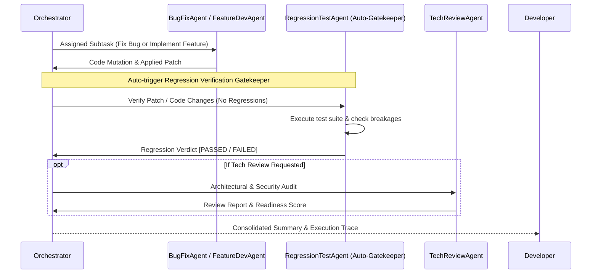

# Specialized AI Agents Specification

This document details the roles, toolsets, reasoning strategies, and input/output contracts for the **4 specialized AI agents** in the Agentic AI Framework.

---

## 1. BugFixAgent

### Mission
Autonomous diagnosis, root-cause investigation, and surgical patch synthesis for software bugs, exceptions, and failing tests.

### Key Capabilities
- **Triage:** Extracts file locations and line numbers from stack traces or failing test outputs.
- **Reconnaissance:** Uses hybrid RAG search to inspect surrounding caller and callee logic.
- **Patch Synthesis:** Authors minimal unified diff patches using `apply_patch`. Avoids broad rewrites to minimize blast radius.
- **Verification:** Executes the project test suite (`pytest`, `npm test`, etc.) to confirm the defect is resolved without unintended side effects.

### Allowed Tools
- `search_code`: Queries hybrid vector/symbol RAG index.
- `read_file`: Reads source files with optional line range slices.
- `apply_patch`: Applies surgical replacement chunks to existing files.
- `write_file`: Writes new files if a helper or patch requires it.
- `run_project_tests`: Executes target project test suite.
- `run_shell`: Runs custom shell diagnostics.
- `analyze_project`: Inspects target tech stack and build tools.

---

## 2. TechReviewAgent

### Mission
Principal architect and security auditor performing deep static analysis, security evaluations, and architectural health checks.

### Audit Dimensions
1. **Security & Safety:**
   - Detects code injection risks (`eval`, `exec`, shell injections).
   - Flags hardcoded credentials, secret keys, or unvalidated user inputs.
   - Audits against OWASP Top 10 vulnerabilities.
2. **Architecture & Design:**
   - Verifies adherence to SOLID principles, DRY, and clean separation of concerns.
   - Flags tight coupling (e.g., domain services mixing with persistence).
3. **Reliability & Error Handling:**
   - Checks defensive validation, null-safety, and exception contracts.
4. **Performance & Code Quality:**
   - Audits algorithmic complexity, dead code, unused imports, typing coverage, and docstring clarity.
5. **Readiness Score:**
   - Produces an objective score from `0` to `100` indicating production readiness.

### Allowed Tools
- `search_code`: Explores related modules and symbol references.
- `read_file`: Audits target source files.
- `list_directory`: Discovers project directory layouts.
- `analyze_project`: Retrieves stack info, language versions, and test setup.

---

## 3. FeatureDevAgent

### Mission
Translates natural language feature specifications into robust software designs and implementations in the target project.

### Workflow
1. **Requirement Decomposition:** Analyzes feature specifications to identify required data structures, APIs, and classes.
2. **Architecture Mapping:** Uses RAG to discover existing codebase conventions, design patterns, and insertion points.
3. **Implementation:** Scaffolds new modules using `write_file` or updates existing services with `apply_patch`.
4. **Defensive Coding:** Includes docstrings, type annotations, and error handling matching target project standards.

### Allowed Tools
- `search_code`
- `read_file`
- `write_file`
- `apply_patch`
- `list_directory`
- `run_project_tests`
- `analyze_project`

---

## 4. RegressionTestAgent

### Mission
**Autonomous Regression Verification Gatekeeper for BugFixAgent and FeatureDevAgent.**
Its sole and dedicated purpose is to verify that code modifications produced by `BugFixAgent` or `FeatureDevAgent` have NOT caused any regression issues in the target project.

> [!IMPORTANT]
> **Auto-Execution Rule:**
> `RegressionTestAgent` automatically runs immediately whenever `BugFixAgent` or `FeatureDevAgent` runs. It is exclusively dedicated to regression verification of code changes made by these two agents.

### Verification Protocol
1. **Context Review:** Inspects the patches, diffs, and files modified by `BugFixAgent` or `FeatureDevAgent` in the preceding step.
2. **Suite Execution:** Calls `run_project_tests` immediately to execute the target project's test runner (`pytest`, `npm test`, `cargo test`, `go test`) across existing test cases.
3. **Regression Detection:**
   - Detects whether any previously passing tests failed.
   - Detects if modified code introduced broken imports, runtime errors, or breaking API changes.
4. **Lockdown with Regression Tests:**
   - If needed, authors targeted regression test assertions using `apply_patch` or `write_file` to lock down the bug fix or feature against future regressions.
5. **Definitive Regression Verdict:**
   - Issues a final status: `[REGRESSION STATUS: PASSED]` (zero regressions) or `[REGRESSION STATUS: FAILED]` with an actionable breakdown.

### Allowed Tools
- `search_code`: Analyzes call sites and affected code.
- `read_file`: Inspects test files and source files.
- `write_file`: Authors regression tests if needed.
- `apply_patch`: Adds assertions to existing test files.
- `run_project_tests`: Executes target project test runner.
- `run_shell`: Executes custom diagnostics if needed.
- `list_directory`: Discovers test directory layout.
- `analyze_project`: Detects test frameworks and package runners.

---

## 5. Inter-Agent Communication & Shared State

When running in **Multi-Agent Orchestrator** mode, agents communicate via a shared `OrchestratorState`. Notice how `RegressionTestAgent` is automatically triggered as a gatekeeper after code mutations:

