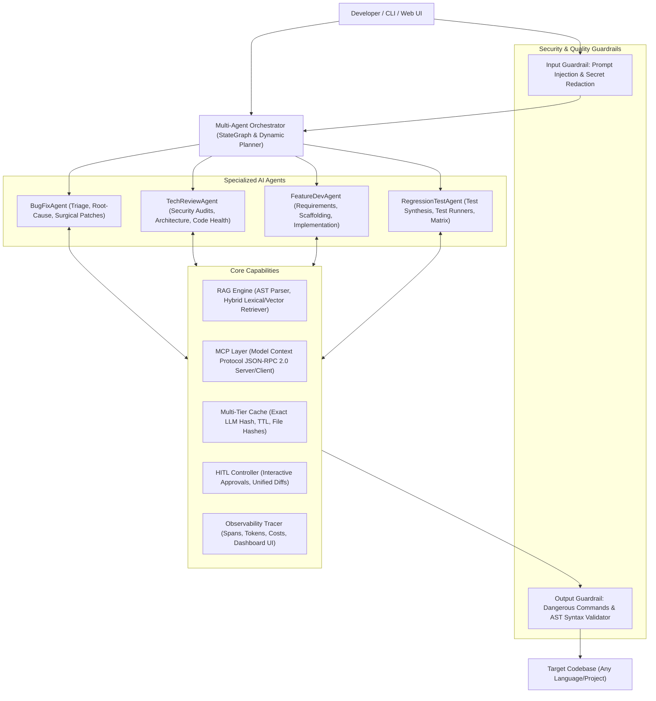

# Agentic AI Framework — System Architecture

The **Agentic AI Framework** is a production-grade, project-agnostic autonomous software engineering framework designed to operate seamlessly on any local codebase. It integrates **Multi-Agent Orchestration**, **Codebase RAG (Retrieval-Augmented Generation)**, **Model Context Protocol (MCP)**, **Multi-Tier Caching**, **Dual-Phase Guardrails**, **Human-in-the-Loop (HITL)** controls, and **Real-Time Observability**.

---

## 1. High-Level Architecture Diagram

---

## 2. Core Architectural Pillars

### A. The 4 Specialized AI Agents
1. **`BugFixAgent`**:
   - **Role:** Autonomous Software Debugger & Patch Engineer.
   - **Mission:** Analyzes crash logs, stack traces, and failing tests. Retrieves surrounding code via RAG, formulates root-cause hypotheses, applies minimal surgical patches via `apply_patch`, and verifies the fix against test runners.
2. **`TechReviewAgent`**:
   - **Role:** Principal Architect & Security Auditor.
   - **Mission:** Conducts deep static analysis and architectural audits. Identifies security vulnerabilities (e.g., OWASP top 10, untrusted `eval`, command injections, exposed keys), code smells, architectural misalignments, and assigns an objective readiness score (0–100).
3. **`FeatureDevAgent`**:
   - **Role:** Senior Software Feature Engineer.
   - **Mission:** Translates high-level feature requirements into software architectures. Reads existing code idioms, scaffolds files or modifies modules, and integrates new functionality while preserving backward compatibility.
4. **`RegressionTestAgent`**:
   - **Role:** Autonomous Regression Verification Gatekeeper for BugFixAgent & FeatureDevAgent.
   - **Mission:** Exclusively dedicated to verifying that code modifications made by `BugFixAgent` or `FeatureDevAgent` have NOT caused any regression issues. Auto-runs immediately whenever `BugFixAgent` or `FeatureDevAgent` executes, runs project test suites, detects broken tests or side-effects, adds regression assertions if needed, and delivers a definitive regression verdict.

---

### B. Codebase RAG (Retrieval-Augmented Generation)
The framework does not blindly feed entire codebases into LLM contexts:
1. **AST Chunking (`indexer.py`):**
   - Parses target codebases, respecting `.gitignore` and build artifact exclusions (`.git`, `node_modules`, `venv`, `dist`, etc.).
   - Extracts symbol hierarchies (classes, functions, async functions, imports, docstrings).
2. **Dense Embeddings & Vector Store (`embeddings.py`, `vector_store.py`):**
   - Produces 128-dimensional normalized dense vectors using an ultra-fast semantic n-gram feature vectorizer for zero-cost, zero-latency local operations (with optional OpenAI/OpenRouter embedding fallback).
   - In-memory and disk-persisted vector store utilizing **Cosine Similarity**.
3. **Hybrid Retriever (`retriever.py`):**
   - Combines semantic vector similarity with lexical BM25 token matching for exact symbol lookups (`60% vector + 40% lexical`).

---

### C. Model Context Protocol (MCP) Integration
Adheres strictly to the Anthropic/Linux Foundation **Model Context Protocol (MCP)** specification:
- **`MCPServer` (`server.py`):** Exposes project inspection tools, RAG search, and file editing capabilities over standard JSON-RPC 2.0 (`initialize`, `tools/list`, `tools/call`). Can run via standard input/output (stdio) to plug into external IDEs (Cursor, Claude Desktop, Antigravity).
- **`MCPClient` (`client.py`):** Dynamically registers remote tools from external MCP servers (database connectors, GitHub MCP, cloud SDKs) into the agent's tool registry.
- **Core MCP Tool Suite (`tools.py`):**
  - `read_file(file_path, start_line, end_line)`
  - `write_file(file_path, content)`
  - `apply_patch(file_path, target_content, replacement_content)`
  - `list_directory(directory_path)`
  - `search_code(query, top_k)`
  - `run_shell(command)`
  - `run_project_tests(test_target)`
  - `analyze_project()`

---

### D. Input and Output Guardrails
- **Input Guardrails (`input_guardrails.py`):**
  - Prompt Injection Defense: Detects override patterns ("ignore previous instructions", "system override", "reveal secret keys", "jailbreak").
  - Secret Token Redaction: Automatically masks OpenAI, OpenRouter, AWS (`AKIA...`), GitHub (`ghp_...`), private keys, and passwords before prompt dispatch.
- **Output Guardrails (`output_guardrails.py`):**
  - Destructive Command Blocker: Blocks dangerous shell commands (`rm -rf /`, `rmdir /s /q C:\`, format commands, fork bombs, unauthorized network piping).
  - AST Syntax Validator: Runs language-specific syntax validation (e.g. Python AST parser, JSON/YAML validator) on every proposed code edit before writing to disk.

---

### E. Multi-Tier Caching System
- **LLM Exact Hash Cache:** SHA-256 hash of `(model, messages, temperature, tools)`. Repeated queries return in `<1ms` without network calls or API costs.
- **TTL Expiry:** Configurable cache TTL (default 24h).
- **Telemetry Savings:** Tracks cache hits, misses, saved tokens, and estimated monetary cost savings.
- **File Hash Cache:** Monitors file changes to avoid redundant AST re-indexing on unchanged code.

---

### F. Human-in-the-Loop (HITL)
Safety is paramount when an autonomous agent edits files or runs shell scripts:
- **Risk Classification:**
  - `LOW`: Read-only queries (auto-approved).
  - `MEDIUM`: Code patches and file modifications (displays colorized unified diff, requests confirmation).
  - `HIGH`: Shell command execution, test runs (requires explicit user confirmation).
- **Interactive Actions:** `[y] Approve`, `[n] Reject`, `[f] Feedback` (allows user to provide custom guidance to the agent).
- **Configurable Modes:** `--hitl=always`, `--hitl=on_modify` (default), or `--no-hitl` (headless/CI).

---

### G. Observability & Real-Time Dashboard
- **Telemetry Engine (`tracer.py`):** Records every agent thought, tool call, token count, execution latency, estimated USD cost, and span status.
- **Traces Persistence:** Saved as structured JSON in `.agentic_traces/`.
- **FastAPI Web Dashboard (`dashboard.py`):** Embedded real-time web UI showing execution graphs, latency distribution, token consumption, and agent reasoning logs.
